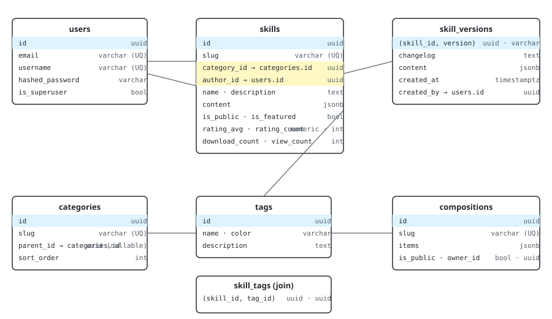

# Data model

The data model is intentionally small and centered on the **skill**.
Most "extras" (tags, dependencies, versions) are join tables or
JSONB columns so the schema can evolve without migrations.

## Tables

### `users`

The actors of the system.

| Column            | Type         | Notes                              |
|-------------------|--------------|------------------------------------|
| `id`              | `uuid`       | Primary key                        |
| `email`           | `varchar`    | Unique                             |
| `username`        | `varchar`    | Unique                             |
| `hashed_password` | `varchar`    | bcrypt, cost factor 12             |
| `full_name`       | `varchar`    | Optional                           |
| `is_active`       | `bool`       | Default `true`                     |
| `is_superuser`    | `bool`       | Default `false`                    |
| `created_at`      | `timestamptz`| Server time                        |

### `skills`

The core entity.

| Column           | Type         | Notes                                       |
|------------------|--------------|---------------------------------------------|
| `id`             | `uuid`       | Primary key                                 |
| `slug`           | `varchar`    | Unique, used in URLs                        |
| `name`           | `varchar`    | Display name                                |
| `description`    | `text`       | Short, used in cards                         |
| `content`        | `jsonb`      | The full body (markdown + metadata)         |
| `category_id`    | `uuid`       | FK → `categories.id`                        |
| `author_id`      | `uuid`       | FK → `users.id` (nullable)                  |
| `version`        | `varchar`    | SemVer                                      |
| `license`        | `varchar`    | SPDX identifier                             |
| `is_public`      | `bool`       | Visible without auth                        |
| `is_featured`    | `bool`       | Surfaced on the home page                   |
| `rating_avg`     | `numeric`    | 0–5                                         |
| `rating_count`   | `int`        |                                             |
| `download_count` | `int`        |                                             |
| `view_count`     | `int`        |                                             |
| `usage_count`    | `int`        |                                             |
| `created_at`     | `timestamptz`| Server time                                 |
| `updated_at`     | `timestamptz`| Server time, auto-updated                   |

### `skill_versions`

Append-only history of every released version. Every time a user
edits a skill and bumps the version, a new row is inserted.

| Column       | Type         | Notes                          |
|--------------|--------------|--------------------------------|
| `id`         | `uuid`       | Primary key                    |
| `skill_id`   | `uuid`       | FK → `skills.id`               |
| `version`    | `varchar`    | SemVer, unique per skill       |
| `changelog`  | `text`       | Markdown                       |
| `content`    | `jsonb`      | Snapshot of the body           |
| `created_at` | `timestamptz`|                                |
| `created_by` | `uuid`       | FK → `users.id`                |

### `categories`

A two-level taxonomy (top-level + child).

| Column      | Type         | Notes                          |
|-------------|--------------|--------------------------------|
| `id`        | `uuid`       | Primary key                    |
| `slug`      | `varchar`    | Unique                         |
| `name`      | `varchar`    |                                |
| `parent_id` | `uuid`       | FK → `categories.id` (nullable) |
| `sort_order`| `int`        |                                |
| `icon`      | `varchar`    | Icon name (Lucide)             |
| `is_active` | `bool`       |                                |

### `tags`

Free-form labels for skills.

| Column       | Type      | Notes                          |
|--------------|-----------|--------------------------------|
| `id`         | `uuid`    | Primary key                    |
| `name`       | `varchar` | Unique                         |
| `color`      | `varchar` | Hex                            |
| `description`| `text`    |                                |

### `skill_tag_association`

Many-to-many join. Lives in its own table (not auto-managed
by SQLAlchemy) so the composite primary key can be enforced.

| Column    | Type  | Notes                          |
|-----------|-------|--------------------------------|
| `skill_id`| `uuid`| FK → `skills.id`               |
| `tag_id`  | `uuid`| FK → `tags.id`                 |

### `skill_dependencies`

Directed graph of "skill A depends on skill B (at version ≥ N)".

| Column               | Type      | Notes                                              |
|----------------------|-----------|----------------------------------------------------|
| `id`                 | `uuid`    | Primary key                                        |
| `skill_id`           | `uuid`    | FK → `skills.id`                                   |
| `depends_on_skill_id`| `uuid`    | FK → `skills.id`                                   |
| `version_constraint` | `varchar` | SemVer constraint, e.g. `>=1.2.0,<2.0.0`           |
| `is_required`        | `bool`    | `false` = soft (preferred) dependency               |
| `created_at`         | `timestamptz`|                                                  |

### `skill_ratings`

One row per (user, skill). Updated in place when the user
re-rates.

| Column      | Type         | Notes                            |
|-------------|--------------|----------------------------------|
| `id`        | `uuid`       | Primary key                      |
| `skill_id`  | `uuid`       | FK → `skills.id`                 |
| `user_id`   | `uuid`       | FK → `users.id`                  |
| `rating`    | `int`        | 1–5                              |
| `comment`   | `text`       | Optional, max 2 000 chars        |
| `created_at`| `timestamptz`|                                  |
| `updated_at`| `timestamptz`|                                  |

### `skill_usage_logs`

Append-only log of "user X did Y to skill Z" events. Powers
the analytics dashboard. Not a replacement for the
`analytics_events` table described in early drafts — that
table was never materialised; the audit log via
`app.core.audit.log_event` is the only event sink today.

| Column       | Type         | Notes                                            |
|--------------|--------------|--------------------------------------------------|
| `id`         | `uuid`       | Primary key                                      |
| `skill_id`   | `uuid`       | FK → `skills.id`                                 |
| `user_id`    | `uuid`       | FK → `users.id` (nullable for anonymous events)  |
| `action`     | `varchar`    | `view` · `download` · `use` · `rate` · `share`   |
| `ip_address` | `varchar`    | Hashed before persistence                        |
| `user_agent` | `varchar`    |                                                  |
| `created_at` | `timestamptz`|                                                  |

### `skill_compositions`

The composition itself — a named, versioned group of skills.

| Column       | Type         | Notes                              |
|--------------|--------------|------------------------------------|
| `id`         | `uuid`       | Primary key                        |
| `slug`       | `varchar`    | Unique                             |
| `name`       | `varchar`    |                                    |
| `description`| `text`       |                                    |
| `is_public`  | `bool`       |                                    |
| `owner_id`   | `uuid`       | FK → `users.id`                    |
| `created_at` | `timestamptz`|                                    |
| `updated_at` | `timestamptz`|                                    |

### `skill_composition_items`

Ordered list of skills inside a composition. The items are
relational (not a JSONB column on the parent) so they can be
re-ordered, indexed, and FK-validated.

| Column          | Type  | Notes                            |
|-----------------|-------|----------------------------------|
| `id`            | `uuid`| Primary key                      |
| `composition_id`| `uuid`| FK → `skill_compositions.id`     |
| `skill_id`      | `uuid`| FK → `skills.id`                 |
| `sort_order`    | `int` | Display order inside composition |
| `notes`         | `text`| Free-form per-item comment       |

## Indexes

Every table has a `created_at` index. Foreign keys are indexed. The
`skills` table has additional composite indexes for the most common
queries:

- `(category_id, is_public, is_featured)` — home page
- `GIN(to_tsvector('english', name || ' ' || description))` —
  lexical search fallback
- `(author_id)` — "skills by user" pages

## Why JSONB for `content` and `items`?

Skills and compositions are **user-authored** and have an evolving
shape. Forcing them into relational columns would require a
migration every time the schema changes. Storing them as JSONB and
validating on read/write with Pydantic gives us:

- Schema flexibility
- GIN indexes for "where the JSON contains X" queries
- A single source of truth for the shape (Pydantic)

See [ADR 004](../adr/004-jsonb-flexible-content.md) for the full
discussion.

## Where to go from here

- [Search pipeline](../search.md) — how the index is built
- [Schema source](https://github.com/badhope/AI-SKILL/blob/main/backend/app/models/skill.py) — the SQLAlchemy
  models
- [Migrations](../development/migrations.md) — how the schema
  evolves
